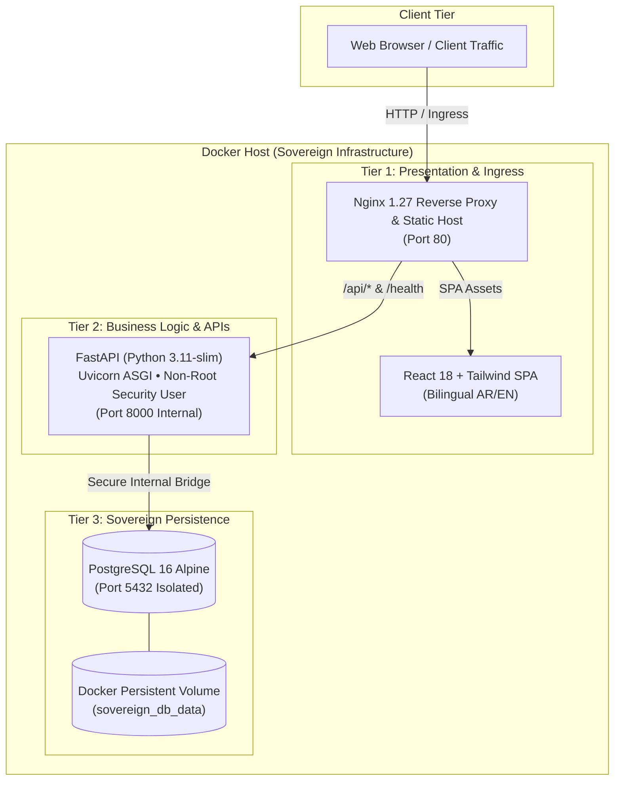

# منصة راصد السحابية السيادية | Sovereign Cloud Adoption Hub
### Enterprise Dockerized 3-Tier Web Application for Sovereign Cloud Workload Governance

[](https://www.docker.com/)
[](https://fastapi.tiangolo.com/)
[](https://react.dev/)
[](https://www.postgresql.org/)
[](https://nginx.org/)
[](LICENSE)

---

## Overview (English)

**Rased Cloud Hub** is a working, fully containerized 3-tier application (React · FastAPI · PostgreSQL behind Nginx) that simulates what a sovereign cloud adoption program actually has to prove: enterprise workloads moving to the cloud while continuously verifying Saudi regulatory alignment.

It models three national frameworks, provider-agnostically:

1. **Data Residency (NDMO)** — sensitive data must remain 100% inside the Kingdom's geography, on approved local data centers.
2. **Cybersecurity Controls (NCA ECC)** — systems are measured against NCA Essential Cybersecurity Controls, with numeric compliance indicators.
3. **Cloud Classification (CST)** — workloads are classified into the CST cloud framework's approved tiers (`Class A`, `Class B`, `Class C`).

**Why it matters:** most migration demos stop at "the containers run." This one makes the compliance posture a first-class, queryable part of the application — the questions an adoption manager actually gets asked (Where does this workload's data live? Does it meet NCA ECC? What CST class is it?) have API-level answers.

**Run it in one command** — see [Quick Start](#quick-start-one-command-run).

---

## مقدمة المشروع (باللغة العربية)

### نبذة عن المشروع وأهدافه الإستراتيجية
يُمثّل هذا المشروع نموذجاً تطبيقياً متقدماً **لمعمارية الحوسبة ثلاثية الطبقات (3-Tier Cloud Architecture)** المبنية بالكامل عبر الحاويات البرمجية (Dockerized Containers)، والمصممة لتسليط الضوء على الدور القيادي والتقني **لمدير تبني الحلول السحابية (Cloud Adoption Manager)** في مزوّدي الخدمات السحابية الوطنية والمحلية في المملكة العربية السعودية.

تم تطوير النظام تحت مسمى **«منصة راصد السحابية» (Rased Cloud Hub)**، وهي منصة استرشادية تُعنى بإدارة ومتابعة ترحيل حمولات العمل المؤسسية (Workload Cloud Migration)، والتحقق اللحظي من استيفاء المعايير التنظيمية الوطنية لحوكمة وأمن البيانات دون أي انحياز تجاري أو تبعية لمزود محدد:

1. **توطين واستضافة البيانات السيادية (Data Residency)**:
   - الالتزام التام بمتطلبات **مكتب إدارة البيانات الوطنية (NDMO)** لضمان بقاء البيانات الحساسة ومعالجتها بنسبة **100%** داخل النطاق الجغرافي للمملكة وفي مراكز بيانات محلية معتمدة.
2. **الضوابط الأساسية للأمن السيبراني (NCA ECC)**:
   - قياس ومراقبة التزام الأنظمة بضوابط **الهيئة الوطنية للأمن السيبراني (NCA)** عبر مؤشرات أداء رقمية وتصنيفات رقابية متقدمة.
3. **تصنيف حمولات العمل والبيانات السحابية (CST Framework)**:
   - تصنيف الأنظمة وفق الإطار التنظيمي للحوسبة السحابية الصادر عن **هيئة الاتصالات والفضاء والتقنية (CST)** إلى الفئات المعتمدة (`Class A`، `Class B`، `Class C`).

### القيمة المضافة لمدير تبني الحلول السحابية (Cloud Adoption Value)
- **تسريع اتخاذ القرار**: تحويل رحلة الترحيل السحابي المعقدة إلى مسار رقمي شفاف يربط الجوانب التقنية (Infrastructure & Databases) بالأهداف الإستراتيجية للتحول الرقمي وفق **رؤية السعودية 2030**.
- **المعمارية المعزولة والآمنة**: ضمان أعلى درجات العزل الشبكي (Network Isolation)، والتحكم في النفاذ عبر بوابات آمنة (Reverse Proxy)، واستخدام مستخدمين غير جذريين (Non-root users) داخل الحاويات.

---

## System Architecture Overview

The application follows the classic, enterprise-hardened **3-Tier Architecture Pattern**, decoupled into isolated, production-tuned containers:



### Component Details
1. **Tier 1 — Presentation Layer (`sovereign_web_tier`)**:
   - **Engine**: Nginx Alpine serving pre-compiled static assets and reverse-proxying API traffic.
   - **Frontend UI**: Built with React 18, Vite, and Tailwind CSS.
   - **Features**: Dual-language support (Arabic RTL by default & English LTR toggle), interactive KPI metrics, real-time workload registration modal, and official Saudi green color theme (`#006C35`).
   - **Security Headers**: Injected at proxy level (`X-Frame-Options`, `X-Content-Type-Options`, `X-XSS-Protection`).

2. **Tier 2 — Business Logic Layer (`sovereign_api_tier`)**:
   - **Engine**: FastAPI async framework powered by Uvicorn.
   - **Container Hardening**: Multi-stage Docker build, stripped build tools, and executed under an unprivileged `appuser` (non-root) container account.
   - **Interactive Documentation**: Swagger UI served natively at `/docs`.

3. **Tier 3 — Sovereign Data Tier (`sovereign_db_tier`)**:
   - **Engine**: PostgreSQL 16 Alpine.
   - **Isolation**: Not exposed to host ports; accessible exclusively by the backend service through the internal Docker bridge network (`sovereign-net`).
   - **Persistence & Seeding**: Managed via Docker named volumes with automated bootstrap SQL scripts (`scripts/init-db.sql`).

---

## Quick Start (One Command Run)

### Prerequisites
- Docker Engine 24.0+
- Docker Compose v2.20+

### Step-by-Step Deployment

1. **Clone the repository**:
   ```bash
   git clone https://github.com/R3dn/dockerized-3tier-app.git
   cd dockerized-3tier-app
   ```

2. **Initialize Environment Variables**:
   ```bash
   cp .env.example .env
   ```
   Then edit `.env` and set your own `POSTGRES_PASSWORD` — the default in `.env.example` is a placeholder for local development only.

3. **Build & Start Containers**:
   ```bash
   docker compose up --build -d
   ```

4. **Verify Container Health**:
   ```bash
   docker compose ps
   ```

5. **Access the System**:
   - **Main Web Application**: [http://localhost](http://localhost)
   - **Interactive API Documentation (Swagger)**: [http://localhost/docs](http://localhost/docs)
   - **Healthcheck & Liveness Endpoint**: [http://localhost/health](http://localhost/health)

---

## Key REST API Endpoints

| Method | Endpoint | Description |
|---|---|---|
| `GET` | `/health` | Cluster health, database connectivity, and sovereign residency check |
| `GET` | `/api/v1/metrics` | Executive KPIs: Total workloads, data residency %, avg NCA compliance |
| `GET` | `/api/v1/workloads` | List enterprise workloads with filters (`sector`, `phase`, `classification`) |
| `POST` | `/api/v1/workloads` | Register a new enterprise workload for cloud adoption |

---

## Cloud Adoption & Cybersecurity Compliance Alignment

This architecture demonstrates competencies required for strategic cloud enablement:

- **Data Sovereignty (NDMO)**: All data records remain strictly inside the local containerized persistent volume, mirroring on-premise or sovereign cloud data center residency mandates.
- **Defense-in-Depth**: Strict separation of concerns — database credentials and internal ports are isolated from public ingress.
- **Cloud-Native Maturity**: Multi-stage builds reduce image footprints, speed up deployment pipelines, and minimize vulnerable dependencies.

---

## Repository Directory Structure

```text
├── backend/
│   ├── app/
│   │   ├── database.py       # SQLAlchemy engine & resilient connection pooling
│   │   ├── main.py           # FastAPI endpoints & CORS configuration
│   │   ├── models.py         # Database ORM models
│   │   └── schemas.py        # Pydantic validation schemas
│   ├── Dockerfile            # Multi-stage Python 3.11 non-root build
│   └── requirements.txt      # Python dependencies
├── frontend/
│   ├── src/
│   │   ├── components/       # Header, KPICards, WorkloadTable, AddWorkloadModal
│   │   ├── App.jsx           # Main application state & bilingual toggler
│   │   ├── index.css         # Tailwind & custom typography styling
│   │   └── main.jsx          # React SPA entrypoint
│   ├── Dockerfile            # Multi-stage Node.js build
│   ├── index.html            # HTML shell with IBM Plex Sans Arabic font
│   ├── package.json          # Frontend dependencies
│   ├── tailwind.config.js    # Tailwind styling with authentic Saudi Green palette
│   └── vite.config.js        # Vite bundler configuration
├── nginx/
│   ├── Dockerfile            # Nginx 1.27 + compiled frontend bundle
│   └── nginx.conf            # Reverse proxy rules, security headers, SPA fallback
├── scripts/
│   └── init-db.sql           # Database schema & pre-seeded Saudi enterprise workloads
├── .env.example              # Environment variable template
├── .gitignore                # Git exclusions
├── docker-compose.yml        # Multi-container orchestration
└── README.md                 # Bilingual documentation & architecture portfolio
```
